# Otimização de Web Services — Streaming de Música

Trabalho Prático A2 — Análise e Otimização de Sistemas (UVA) — Prof. André Lucio

- Erik Schoenherr Menezes - 1230106022
- Renan Pinto Pereira da Costa - 1230212344

Repositorio - https://github.com/RenanppCosta/A2_AOS

## 1. Introdução

Este trabalho prático tem como objetivo aplicar e avaliar experimentalmente técnicas de otimização de desempenho em Web Services REST conectados a um banco de dados relacional. Foi desenvolvida uma API de **streaming de música** (artistas, álbuns e músicas) com **100.000 músicas**, **10.000 álbuns** e **1.000 artistas**, sobre a qual foram implementados e medidos três pilares de otimização:

1. **Cache em memória (Caffeine):** redução de acessos repetidos ao banco de dados com política de expiração (TTL) e invalidação explícita em atualizações.
2. **Otimização de consultas ao banco de dados:** comparação empírica entre estratégias de carregamento (`LAZY` e `EAGER`), eliminação do problema N+1 com `JOIN FETCH` e avaliação do impacto de índices compostos com `EXPLAIN ANALYZE`.
3. **Testes de desempenho (Grafana k6):** avaliação quantitativa sob diferentes níveis de carga (10, 50, 100 e 200 usuários virtuais simultâneos), medindo latência média, p95, p99, throughput e taxa de erros.

## 2. Arquitetura e tecnologias

| Camada | Tecnologia |
|---|---|
| API | Spring Boot 4 (Spring Web MVC), Java 21 |
| Persistência | Spring Data JPA + Hibernate |
| Banco | PostgreSQL 16 (Docker) |
| Cache | Caffeine (cache local em memória) |
| Testes de carga | Grafana k6 v2.4.0 |

**Entidades:** `Artist` (1:N) `Album` (1:N) `Music`

**Volume de dados:** 1.000 artistas, 10.000 álbuns, 100.000 músicas (`scripts/02-data.sql`).
### Pré-requisitos

| Ferramenta | Versão | Para quê | Como verificar |
|---|---|---|---|
| JDK | 21 ou superior | compilar e executar a API | `java -version` |
| Docker Desktop | com o engine em execução | PostgreSQL em container | `docker info` |
| Git | qualquer | clonar o repositório | `git --version` |
| PowerShell | 5.1 ou superior (Windows) | scripts de experimento (`.ps1`) | `$PSVersionTable.PSVersion` |
| Grafana k6 | 2.4.0 | testes de carga | `k6 version` |
| Python 3 + matplotlib | qualquer 3.x | gráficos do relatório do k6 | `python --version` |

O Maven **não** precisa ser instalado (o repositório inclui o Maven Wrapper, `mvnw`). Insomnia ou Postman são
opcionais. Portas utilizadas: **8080** (API) e **5433** (PostgreSQL).

Instalação no Windows:
```powershell
winget install k6 --source winget     # depois feche e reabra o terminal
pip install matplotlib                # o numpy é instalado junto
```
### Como executar

```powershell
docker compose up -d            # sobe o PostgreSQL (porta 5433) e popula o banco na 1ª vez
.\mvnw.cmd spring-boot:run      # sobe a API em http://localhost:8080
# recriar o banco do zero:  docker compose down -v ; docker compose up -d
```

> O banco usa a porta **5433** no host porque a 5432 pode estar ocupada por um PostgreSQL local.

### Endpoints

| Método | Rota | Descrição |
|---|---|---|
| GET | `/api/music/top50/sem-cache` | Ranking das 50 músicas mais tocadas, sempre no banco |
| GET | `/api/music/top50/com-cache` | Ranking Top 50 usando cache (Caffeine) |
| GET | `/api/music/{id}/sem-cache` | Busca a música sempre no banco |
| GET | `/api/music/{id}/com-cache` | Busca a música usando cache (Caffeine) |
| GET | `/api/music/album/{albumId}` | Músicas de um álbum ordenadas por reproduções (cenário de índice) |
| PUT | `/api/music/{id}` | Atualiza `title`/`reproductions` e invalida os caches afetados |
| GET | `/api/cache/stats` | Hits, misses, hitRate e tamanho de cada cache |
| DELETE | `/api/cache` | Limpa os caches (cache frio) |
| GET | `/api/albums/lazy?limit=N` | Álbuns + músicas com LAZY (N+1) |
| GET | `/api/albums/eager?limit=N` | Álbuns + músicas com EAGER |
| GET | `/api/albums/optimized?limit=N` | Álbuns + músicas com JOIN FETCH |
| GET | `/api/albums/lazy-albums-only?limit=N` | Só álbuns (LAZY) |
| GET | `/api/albums/eager-albums-only?limit=N` | Só álbuns (EAGER carrega músicas à toa) |

Os endpoints `/api/albums/*` devolvem um relatório (`QueryReport`): quantidade de SQLs
executados, entidades carregadas e tempo. Os contadores do Hibernate são globais, então
use esses endpoints **uma requisição por vez** (evidência). Exceção: o Cenário 2 do k6 (seção 5) os chama sob
carga; nele o relatório é ignorado (o k6 só confere o status 200) e o custo de coletar as estatísticas é o mesmo
nas três estratégias, então a comparação continua justa, mas as latências absolutas incluem esse custo.

## 3. Implementação de cache

### 3.1 Identificação de informações cacheáveis

Foram avaliadas duas operações de consulta. O **Top 50** é o dado principal do experimento; a
**busca por id** entra como contraste, para mostrar que o cache nem sempre compensa.

| Critério (seção 3.1) | Top 50 músicas mais tocadas | Busca de uma música por id |
|---|---|---|
| Frequência de acesso | Alta: é a vitrine de um serviço de streaming, lida por muitos usuários | Média: depende da música |
| Volatilidade | Média: `reproductions` muda, mas o topo do ranking varia devagar em relação à frequência de leitura | Média: o contador da música muda a cada atualização |
| Custo de recuperação | **Alto**: ordena as 100 mil músicas por `reproductions` (sem índice) e junta o álbum | **Baixo**: busca por chave primária |
| Consequência de dado desatualizado | Baixa: um ranking defasado por até 60 s é aceitável | Baixa |
| Necessidade de invalidação | Sim: uma atualização pode mudar a ordem do ranking | Sim: a entrada da música muda |

**Decisão:** o Top 50 é o melhor candidato (lido com frequência, caro de calcular e tolerante a
pequenos atrasos). A busca por id foi mantida em cache apenas como contraste.

### 3.2 Implementação das duas versões

| Cenário | Endpoint | Comportamento |
|---|---|---|
| A — sem cache | `GET /api/music/top50/sem-cache` | Consulta o banco em toda requisição |
| B — com cache | `GET /api/music/top50/com-cache` | Consulta o banco só em *cache miss* |

As duas versões executam a **mesma consulta**; a única diferença é a anotação `@Cacheable`.
A busca por id segue o mesmo padrão (`/api/music/{id}/sem-cache` e `/api/music/{id}/com-cache`).

```java
// Cenário A: sempre vai ao banco
@Transactional(readOnly = true)
public List<MusicDTO> top50WithoutCache() { return loadTop50(); }

// Cenário B: só vai ao banco em cache miss (ou depois do TTL / invalidação)
@Cacheable(cacheNames = CacheConfig.TOP_MUSICS_CACHE, key = "'top50'")
@Transactional(readOnly = true)
public List<MusicDTO> top50WithCache() { return loadTop50(); }
```

```sql
-- Consulta executada pelo Hibernate (aparece no log a cada acesso ao banco):
select ... from music m join album a on a.id = m.album_id
order by m.reproductions desc, m.id fetch first 50 rows only
```

### 3.3 Tecnologia de cache

Foi usado o **Caffeine**, um cache em memória dentro da própria aplicação.

- **Por que:** não exige servidor extra, tem latência mínima (não há rede), oferece TTL e limite
  de tamanho nativamente e expõe estatísticas de *hit* e *miss* (`recordStats()`), que usamos
  no endpoint `/api/cache/stats`.
- **Alternativas:** o **Redis** é um cache distribuído; compartilharia o cache entre várias
  instâncias da aplicação, mas exigiria um serviço adicional e uma ida pela rede a cada consulta,
  o que não se justifica em um experimento de uma única instância. Hazelcast e Infinispan são
  mais pesados para este escopo.
- **Limitação:** cada instância da aplicação teria o seu próprio cache (ver riscos em 3.4).

### 3.4 Tempo de vida (TTL) e invalidação

```java
Caffeine.newBuilder()
        .expireAfterWrite(60, TimeUnit.SECONDS)   // TTL de 60 s, contado a partir da gravação
        .maximumSize(10_000)
        .recordStats();
```

- **TTL (60 s):** após 60 s da gravação, a entrada expira sozinha. A leitura **não** renova o prazo.
- **Invalidação:** `PUT /api/music/{id}` remove a entrada da música e **todo** o cache do Top 50
  (`@Caching` + `@CacheEvict`), porque a atualização pode mudar a ordem do ranking.
- **Por que as duas:** a invalidação garante que mudanças feitas pela aplicação apareçam
  imediatamente; o TTL é a rede de segurança para qualquer mudança que não passe por ela.

#### Experimento obrigatório (seção 3.4)

Executado por `experiments/cache-experiment.ps1` (aquecimento da JVM antes, banco com 100 mil músicas):

```powershell
powershell -ExecutionPolicy Bypass -File .\experiments\cache-experiment.ps1
```

| # | Passo | Etapa do enunciado | Resultado esperado |
|---|---|---|---|
| 1 | 1ª consulta ao Top 50 | consultar e registrar o comportamento | **MISS**: vai ao banco |
| 2 | 2ª consulta | repetir e verificar o reaproveitamento | **HIT**: sem acesso ao banco |
| 3 | `PUT` na música 10 (nova quantidade de reproduções) | modificar pela aplicação | atualiza o banco e invalida o cache |
| 4 | consulta após o `PUT` | verificar se o dado está atualizado | **MISS**, ranking já atualizado |
| 5 | consulta seguinte | | **HIT** |
| 6 | consulta 65 s depois, sem nenhuma atualização | demonstrar a expiração | **MISS** (TTL expirou) |

**Resultado medido:**

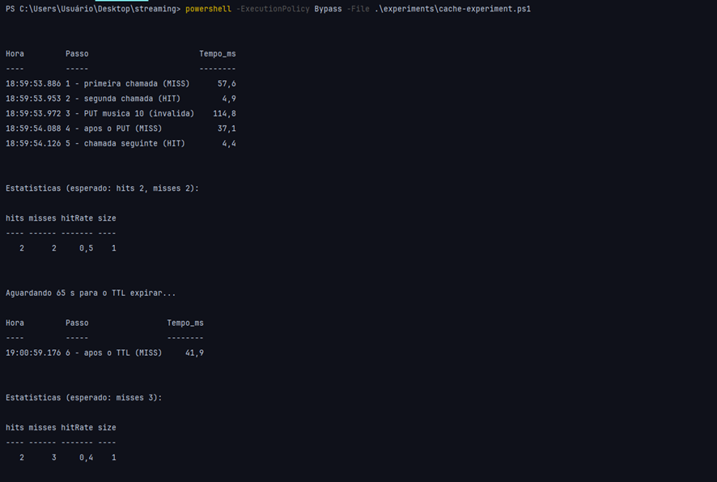

| Hora | Passo | Tempo (ms) | Foi ao banco? |
|---|---|---|---|
| 18:59:53.886 | 1 — primeira chamada (MISS) | 57,6 | sim |
| 18:59:53.953 | 2 — segunda chamada (HIT) | 4,9 | **não** |
| 18:59:53.972 | 3 — PUT música 10 (invalida) | 114,8 | sim (`select` por id + `update`) |
| 18:59:54.088 | 4 — após o PUT (MISS) | 37,1 | sim |
| 18:59:54.126 | 5 — chamada seguinte (HIT) | 4,4 | **não** |
| 19:00:59.176 | 6 — após o TTL (MISS) | 41,9 | sim |

Estatísticas do cache `top-musics`: depois do passo 5, `hits = 2`, `misses = 2`, `hitRate = 0,5`;
depois do passo 6, `hits = 2`, `misses = 3`, `hitRate = 0,4`, `size = 1`.

**Log da aplicação durante o experimento** (cada linha `org.hibernate.SQL` é um acesso ao banco):

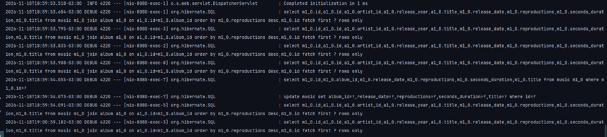

| Hora no log | Linha | Corresponde a |
|---|---|---|
| 18:59:53.604 / .795 / .835 | `select ... order by reproductions desc` (3x) | aquecimento (`sem-cache`) |
| 18:59:53.908 | `select ... order by reproductions desc` | passo 1 — **MISS** |
| *(nenhuma linha)* | | passo 2 — **HIT** |
| 18:59:54.055 | `select ... from music where id=?` | passo 3 — o `PUT` lê a música 10 |
| 18:59:54.073 | `update music set ...` | passo 3 — o `PUT` grava no banco |
| 18:59:54.091 | `select ... order by reproductions desc` | passo 4 — **MISS** (cache invalidado) |
| *(nenhuma linha)* | | passo 5 — **HIT** |
| 19:00:59.182 | `select ... order by reproductions desc` | passo 6 — **MISS** (TTL expirou) |

**Conclusões do experimento:**
- **Reaproveitamento:** nos passos 2 e 5 não há `select` no log: a resposta veio do cache.
- **Invalidação:** após o `PUT`, o passo 4 voltou ao banco e já trouxe o dado atualizado.
- **TTL:** entre o passo 5 e o passo 6 passaram-se cerca de 65 s sem nenhuma atualização, e mesmo
  assim o `select` voltou a aparecer: a entrada expirou sozinha.

**Dado desatualizado.** A estratégia permite dado desatualizado em dois casos: (1) se o banco for
alterado por fora da aplicação (script SQL, outro serviço), o cache só se corrige quando o TTL
expira, ou seja, por até 60 s; (2) com mais de uma instância da aplicação, o `@CacheEvict` limpa
apenas o cache da instância que recebeu o `PUT`. Em ambos os casos o risco é o usuário ver um
ranking defasado por no máximo o tempo do TTL.

### 3.5 Análise de desempenho do cache

#### Resultado do experimento (Top 50)

| Métrica | Sem cache | Com cache |
|---|---|---|
| Tempo de resposta (média, 10 chamadas; ver tabela abaixo) | 34 ms | 2,8 ms (*hit*) |
| Acessos ao banco (5 consultas do experimento 3.4: passos 1, 2, 4, 5 e 6) | 5 | **3** (passos 1, 4 e 6) |
| Hit / miss no experimento 3.4 | — | 2 *hits* e 3 *misses* (`hitRate` = 0,4) |

O *hit* foi cerca de **12 vezes mais rápido** que a consulta sem cache (34 → 2,8 ms, redução de
≈ 92%) e, no experimento 3.4, eliminou 2 dos 5 acessos ao banco. O tempo medido inclui o HTTP
local e o PowerShell, portanto o ganho efetivo no banco é maior. Os *hits* do experimento 3.4
(4,9 e 4,4 ms) foram um pouco mais lentos que a média da comparação (2,8 ms) porque são apenas
duas amostras, medidas logo após invalidações.

#### Comparação com × sem cache (10 chamadas cada)

Executado por `experiments/cache-comparison.ps1`:

```powershell
powershell -ExecutionPolicy Bypass -File .\experiments\cache-comparison.ps1
```

| Operação | Média (ms) | Mín (ms) | Máx (ms) |
|---|---|---|---|
| Top 50 — sem cache | 34 | 32,3 | 37,7 |
| Top 50 — com cache (MISS) | 50,8 | 50,8 | 50,8 |
| Top 50 — com cache (HIT) | 2,8 | 2,5 | 3,4 |
| Busca por id — sem cache | 4,6 | 4,2 | 5,1 |
| Busca por id — com cache (MISS) | 6,7 | 6,7 | 6,7 |
| Busca por id — com cache (HIT) | 2,5 | 1,2 | 11,5 |


Estatísticas ao final: cada cache registrou 10 *hits* e 1 *miss* (`hitRate` ≈ 0,91). Os
*misses* foram medidos com uma única chamada cada, portanto são amostras isoladas. Na busca por
id, a média do HIT (2,5 ms) é puxada por um valor isolado de 11,5 ms; sem ele, a média cairia
para ≈ 1,5 ms.

#### Efeito do TTL e da invalidação

- **TTL:** dentro dos 60 s a leitura é servida do cache; passado o prazo a entrada expira e a próxima
  leitura é um *miss* que repovoa o cache (passo 6).
- **Invalidação:** cada `PUT` limpa o Top 50, então a leitura seguinte é sempre um *miss*
  (passo 4). Com poucas atualizações isso é irrelevante; com muitas, o cache perde eficácia.
  No experimento, o `hitRate` caiu para 0,4 justamente por causa da invalidação e do TTL.

#### Perguntas da seção 3.5

**1. Em quais situações o cache apresentou maior benefício?**
Em leituras repetidas do Top 50 dentro da janela do TTL: a consulta ordena 100 mil linhas, então o
*hit* (≈ 2,8 ms) foi cerca de 12 vezes mais rápido que a consulta sem cache (≈ 34 ms), uma
economia de ≈ 31 ms por requisição, e poupou acessos ao banco. Quanto mais leituras por janela de
60 s, maior o benefício.


**2. Como a volatilidade dos dados influenciou a escolha do TTL?**
`reproductions` muda com frequência, mas o topo do ranking varia devagar em relação à frequência
de leitura. Um TTL maior aumenta os *hits*, mas também o tempo máximo de dado desatualizado; um
TTL menor deixa o dado mais fresco, mas gera mais *misses*. Escolheu-se 60 s por tolerar um
ranking defasado por até 1 minuto. A invalidação explícita no `PUT` cobre as mudanças feitas pela
aplicação, e o TTL cobre as demais.

**3. Quais são os riscos de utilizar informações desatualizadas?**
O usuário pode ver um ranking defasado por até o tempo do TTL quando o banco é alterado por fora da
aplicação. Com várias instâncias, o cache local de cada uma só se corrige pelo TTL, e
instâncias diferentes podem mostrar rankings diferentes. Em dados críticos (saldo, estoque,
preço) esse risco seria inaceitável; para um ranking de popularidade é tolerável.

**4. O cache sempre melhorou o desempenho? Justifique com os resultados observados.**
Não. O ganho depende do custo da consulta: no Top 50 o *hit* economizou ≈ 31 ms por
requisição (34 → 2,8 ms); na busca por id, apenas ≈ 2 ms (4,6 → 2,5 ms), porque a consulta por
chave primária já era barata. O *miss* é mais lento que o *sem cache*: faz a mesma consulta e
ainda soma a verificação e a gravação no cache (50,8 ms contra 34 ms no Top 50 e 6,7 ms contra
4,6 ms na busca por id; cada *miss* é uma única amostra, então parte da diferença pode ser
ruído). Para um dado lido uma única vez, o cache só acrescenta custo; ele compensa quando há
*hits* suficientes para cobrir os *misses*. Com atualizações frequentes, cada `PUT` esvazia o
ranking e o `hitRate` cai (0,4 no experimento 3.4), o que reduz o benefício. O cache só compensa
quando a leitura é cara, repetida e tolera pequena defasagem.

## 4. Otimização das consultas

Esta seção investiga como a estratégia de carregamento do relacionamento **Álbum → Músicas** (1:N)
influencia a quantidade de consultas SQL, o tempo de resposta e o volume de dados recuperados, e
como um índice altera o plano de execução de uma consulta.

Os endpoints `/api/albums/*` devolvem um relatório (`QueryReport`) montado com as estatísticas do Hibernate:

| Campo | Significado |
|---|---|
| `albums` / `musics` | álbuns e músicas retornados |
| `sqlStatements` | número de comandos SQL executados (evidência do N+1) |
| `entitiesLoaded` | número de entidades carregadas na sessão (volume de dados recuperado) |
| `timeMs` | tempo da operação medido no servidor |

> Os contadores do Hibernate são globais, então os endpoints foram chamados **uma requisição por vez**.
> Com `limit=5` o objetivo é mostrar o **comportamento** (log do SQL ligado); os tempos dessas chamadas
> únicas incluem aquecimento da JVM e **não** servem para comparar estratégias. A comparação de
> tempos está em 4.3, com aquecimento e média de 5 chamadas.

### 4.1 Estratégia LAZY e o problema N+1

`Album` mapeia as músicas com carregamento sob demanda:

```java
@OneToMany(mappedBy = "album", fetch = FetchType.LAZY)
private List<Music> musics = new ArrayList<>();
```

A operação `GET /api/albums/lazy?limit=N` busca os N primeiros álbuns e, para cada um, acessa a
coleção de músicas:

```java
List<Album> albums = albumRepository.findFirst(PageRequest.of(0, limit));   // 1 query
for (Album a : albums) {
    musics += a.getMusics().size();      // dispara 1 query por álbum (carregamento sob demanda)
}
```

**Resultado com `limit=5`:**


| Hora no log | Linha | Corresponde a |
|---|---|---|
| 20:26:51.509 | `select ... from album ... order by id fetch first ? rows only` | 1 query dos álbuns |
| 20:26:51.515 / .529 / .539 / .549 / .560 | `select ... from music where album_id=?` (5x) | 1 query de músicas **por álbum**, disparada no `getMusics()` |

Total: **6 comandos SQL** (`sqlStatements = 6`), ou seja, 1 + N com N = 5. Esse é o problema **N+1**:
o número de consultas cresce linearmente com o número de álbuns (esperado: 1.001 consultas com
`limit=1000`; confirmado na tabela de 4.3).

### 4.2 Estratégia EAGER

O `fetch` é definido na entidade e vale para qualquer uso dela. Para comparar as duas estratégias
sobre os mesmos dados, a tabela `album` foi mapeada em uma segunda entidade, **somente leitura**,
com carregamento antecipado:

```java
@Entity
@Table(name = "album")
public class AlbumEager {
    @Id private Long id;
    private String title;
    private Integer releaseYear;

    @OneToMany(fetch = FetchType.EAGER)
    @JoinColumn(name = "album_id", insertable = false, updatable = false)
    private List<Music> musics = new ArrayList<>();
}
```

`GET /api/albums/eager?limit=N` executa a mesma operação (busca N álbuns e soma suas músicas).

**Resultado com `limit=5`:**

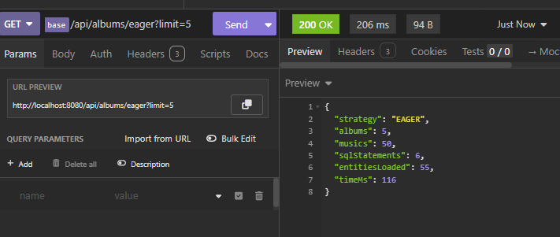
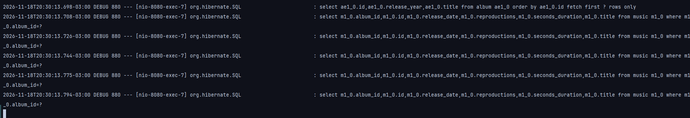

| Hora no log | Linha | Corresponde a |
|---|---|---|
| 20:30:13.698 | `select ... from album ... order by id fetch first ? rows only` | 1 query dos álbuns |
| 20:30:13.708 / .726 / .744 / .775 / .794 | `select ... from music where album_id=?` (5x) | 1 query de músicas por álbum, **logo após** a query principal |

**Observações:**
- **O EAGER não virou uma única consulta:** foram 6 comandos SQL, o mesmo número do LAZY. Isso
  confirma o aviso do enunciado: o carregamento EAGER define *quando* os dados são carregados
  (imediatamente), e não *como* (com `JOIN` ou com consultas separadas). Na consulta JPQL do
  repositório, o Hibernate carregou os álbuns e depois inicializou a coleção de cada um com uma
  query própria.
- **Diferença para o LAZY:** no LAZY as queries extras acontecem quando o código acessa
  `getMusics()`; no EAGER elas acontecem **sempre**, logo após a query principal, mesmo que o código
  nunca use as músicas (comprovado em 4.3, no cenário "só álbuns").
- **Limitação da comparação:** `Album` mapeia a coluna `artist_id` e `AlbumEager` não, então o
  `select` dos álbuns tem uma coluna a mais no LAZY. O que se compara é o tratamento das músicas.

### 4.3 Comparação das estratégias

#### Resultado já medido (limit = 5)

| Estratégia | Comandos SQL | Entidades carregadas | Ocorrência de N+1 |
|---|---|---|---|
| LAZY | 6 | 55 (5 álbuns + 50 músicas) | **Sim** |
| EAGER | 6 | 55 | **Sim** |
| JOIN FETCH (4.4) | 1 | 55 | Não |

O volume de dados recuperado é o mesmo nas três estratégias (55 entidades); o que muda é o número
de idas ao banco.

#### Comparação com quantidades diferentes de registros

Executado por `experiments/lazy-eager-comparison.ps1` (aquecimento + média de 5 chamadas). Para essa
medição o log do SQL foi desligado (`org.hibernate.SQL = INFO`) para não distorcer os tempos, e o banco
estava **sem** o índice `idx_music_album_reproductions` (o efeito do índice sobre essas consultas está em 4.5).

```powershell
powershell -ExecutionPolicy Bypass -File .\experiments\lazy-eager-comparison.ps1
```

| Estratégia | Álbuns | Músicas | Comandos SQL | Entidades carregadas | Tempo médio (ms) | Mín (ms) | Máx (ms) |
|---|---|---|---|---|---|---|---|
| LAZY | 10 | 100 | 11 | 110 | 92,2 | 88 | 99 |
| EAGER | 10 | 100 | 11 | 110 | 86,2 | 85 | 88 |
| JOIN FETCH | 10 | 100 | 1 | 110 | 10,2 | 10 | 11 |
| LAZY | 100 | 1000 | 101 | 1100 | 837,2 | 817 | 875 |
| EAGER | 100 | 1000 | 101 | 1100 | 818,6 | 815 | 824 |
| JOIN FETCH | 100 | 1000 | 1 | 1100 | 16,4 | 16 | 17 |
| LAZY | 1000 | 10000 | 1001 | 11000 | 8204,8 | 8179 | 8236 |
| EAGER | 1000 | 10000 | 1001 | 11000 | 8577,8 | 8276 | 8947 |
| JOIN FETCH | 1000 | 10000 | 1 | 11000 | 87 | 83 | 91 |


#### Efeito de carregar dados desnecessários

Quando o código precisa **apenas dos álbuns** (por exemplo, uma listagem de títulos) e não das músicas:

| Estratégia | Álbuns | Comandos SQL | Entidades carregadas | Tempo médio (ms) |
|---|---|---|---|---|
| LAZY (só álbuns) | 100 | 1 | 100 | 1,4 |
| EAGER (só álbuns) | 100 | 101 | 1100 | 839,2 |
| LAZY (só álbuns) | 1000 | 1 | 1000 | 6 |
| EAGER (só álbuns) | 1000 | 1001 | 11000 | 8317 |

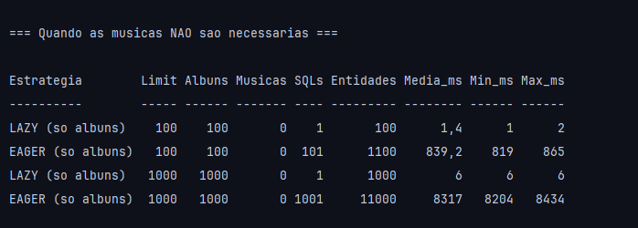

Com `limit=1000`, o LAZY fez 1 comando e carregou 1.000 entidades (6 ms); o EAGER fez 1.001 comandos,
carregou 11.000 entidades (11 vezes mais) e levou 8.317 ms para devolver a mesma lista de álbuns. O EAGER
paga o custo das músicas mesmo quando ninguém as usa.

#### Em quais situações LAZY ou EAGER é mais adequado

- **LAZY é mais adequado** quando o relacionamento nem sempre é usado (listagens que mostram só dados
  do álbum), quando a coleção é grande ou quando o acesso é pontual (detalhe de um único álbum).
  O risco é percorrer a coleção de muitos objetos e cair no N+1 (4.1); nesses casos, combinar com
  `JOIN FETCH` ou busca em lote.
- **EAGER é mais adequado** quando o dado relacionado é pequeno e **sempre** usado junto com a
  entidade principal. Deve ser evitado em coleções grandes ou usadas só às vezes: além de custar
  consultas extras, carrega dados que ninguém lê (ver tabela acima) e **não garante** uma única
  consulta (4.2).
- **Regra prática adotada:** mapear como LAZY e buscar exatamente o necessário em cada caso de uso
  (por exemplo, com `JOIN FETCH`).

### 4.4 Otimização das consultas

A alternativa implementada foi o **`JOIN FETCH`** em JPQL, que traz os álbuns e as músicas em uma
única consulta:

```java
@Query("select distinct a from Album a join fetch a.musics where a.id <= :limit order by a.id")
List<Album> findWithMusics(@Param("limit") long limit);
```

**Resultado com `limit=5`:**

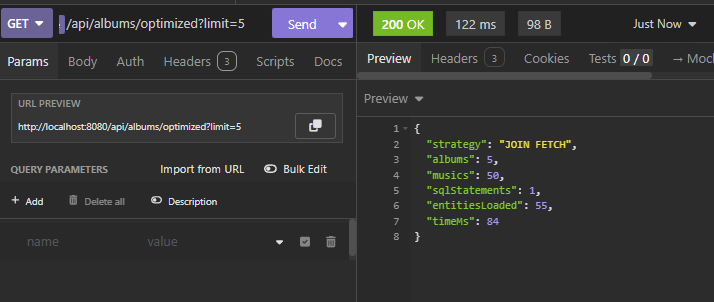
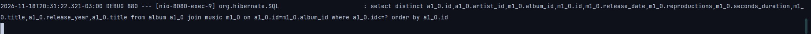

SQL gerado pelo Hibernate (1 único comando):

```sql
select distinct a1_0.id, a1_0.artist_id, m1_0.album_id, m1_0.id, m1_0.release_date, m1_0.reproductions,
       m1_0.seconds_duration, m1_0.title, a1_0.release_year, a1_0.title
from album a1_0 join music m1_0 on a1_0.id = m1_0.album_id
where a1_0.id <= ? order by a1_0.id
```

**Original × otimizada:** com `limit=5`, de 6 comandos SQL (LAZY e EAGER) para **1** (JOIN FETCH),
carregando as mesmas 55 entidades. A comparação de tempos com 10, 100 e 1000 álbuns está na tabela
de 4.3. Nela, na comparação de 1000 álbuns, o LAZY fez 1.001 comandos e 8204,8 ms, enquanto o JOIN FETCH fez 1 comando e 87 ms.

**Cuidados e limitações do `JOIN FETCH`:**
- O `distinct` evita álbuns duplicados no resultado (a junção gera uma linha por música).
- Foi usado `where a.id <= :limit` em vez de paginação: combinar `JOIN FETCH` de coleção com
  paginação faz o Hibernate aplicar a paginação **em memória** (carrega tudo e corta depois).
- A consulta fica específica para o caso de uso, e o resultado maior trafega em uma única resposta.

**Outras alternativas (não implementadas):** projeção em DTO (traz só as colunas necessárias) e busca
em lote (`@BatchSize`, reduz de 1 + N para 1 + N/tamanho do lote).

#### SQL nativo trouxe benefícios reais?

SQL nativo **não foi usado**, e não era necessário: o log mostra que o Hibernate já gerou **uma única
consulta com `JOIN`**, equivalente à que seria escrita à mão. Um SQL nativo não reduziria o número de
comandos nem o tempo neste caso. As consequências de adotá-lo seriam:
- **Portabilidade:** o SQL fica preso ao dialeto do PostgreSQL; JPQL é traduzido para cada banco.
- **Manutenção:** o texto SQL não é validado pelo compilador nem pelo mapeamento (mudanças no schema
  quebram em tempo de execução) e o resultado precisa ser mapeado manualmente para objetos.
- **Perda de recursos do ORM:** entidades retornadas por consulta nativa exigem mais cuidado com o
  contexto de persistência e o carregamento de relacionamentos.
- **Quando valeria a pena:** consultas complexas (funções de janela, CTEs, recursos específicos do
  banco), nas quais o JPQL não consegue expressar a consulta ou o plano gerado é ruim.

### 4.5 Índices (seção 5 do enunciado)

#### Consulta selecionada

```sql
SELECT * FROM music WHERE album_id = 150 ORDER BY reproductions DESC;
```

Combina **filtro** (`album_id`) e **ordenação** (`reproductions`). É também a consulta que o LAZY
executa para cada álbum no N+1, então um índice aqui afeta a aplicação inteira. Pelo schema, a tabela
`music` só tem o índice da chave primária (`music_pkey`), que não atende a esse filtro; o PostgreSQL
não cria índice automático para chave estrangeira.

A API (`GET /api/music/album/{albumId}`, usada no Cenário 3 do k6) executa a mesma busca com `JOIN FETCH` do
álbum; o filtro por `album_id` e a ordenação por `reproductions`, que o índice atende, são os mesmos.

#### Sem índice × com índice

Executado com os comandos de `experiments/indexes.sql`:

```powershell
docker exec -it streaming-db psql -U streaming -c "\d music"
docker exec -it streaming-db psql -U streaming -c "EXPLAIN ANALYZE SELECT * FROM music WHERE album_id = 150 ORDER BY reproductions DESC;"
docker exec -it streaming-db psql -U streaming -c "CREATE INDEX idx_music_album_reproductions ON music (album_id, reproductions DESC);"
docker exec -it streaming-db psql -U streaming -c "ANALYZE music;"
docker exec -it streaming-db psql -U streaming -c "EXPLAIN ANALYZE SELECT * FROM music WHERE album_id = 150 ORDER BY reproductions DESC;"
```

#### Plano de execução

**Sem índice:** 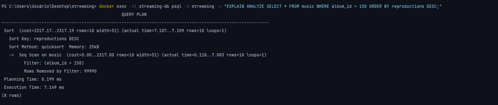

**Com índice:** 

| Item do plano | Sem índice | Com índice |
|---|---|---|
| Operação de acesso à tabela | `Seq Scan on music` | `Index Scan using idx_music_album_reproductions on music` |
| Varredura completa da tabela | Sim | Não |
| Operação de ordenação (`Sort`) | Sim (`quicksort`, `25kB`, `reproductions DESC`) | Não |
| Linhas descartadas pelo filtro (`Rows Removed by Filter`) | `99990` | `0` (`Index Cond: (album_id = 150)`) |
| Linhas retornadas | `10` | `10` |
| Tempo de planejamento (ms) | `0.199` | `0.232` |
| Tempo de execução (ms) | `7.149` | `0.055` |

**Efeito do índice na aplicação (N+1):** repetindo `lazy?limit=1000` (mesma metodologia de 4.3):

| Cenário | Comandos SQL | Tempo médio (ms) |
|---|---|---|
| LAZY, limit=1000, sem índice | 1.001 | 8.204,8 |
| LAZY, limit=1000, com índice | 1.001 | 1.125,6 |

O número de comandos não mudou (continua sendo N+1), mas cada comando ficou mais barato (de `Seq Scan` para
`Index Scan`): o tempo médio do LAZY caiu **86,3%** (≈ 7,3×), e o do EAGER seguiu o mesmo caminho
(8.577,8 → 878,8 ms). Mesmo com o índice, o `JOIN FETCH` (84,4 ms) continua ≈ 13× mais rápido que o LAZY com
índice: o índice atenua o custo do N+1, mas não o elimina. Medições com a mesma metodologia de 4.3 (aquecimento,
média de 5 chamadas, log SQL desligado).

**Custo em espaço:**

| Objeto | Tamanho |
|---|---|
| Tabela `music` | `8536 kB` |
| Índice `idx_music_album_reproductions` | `3104 kB` |
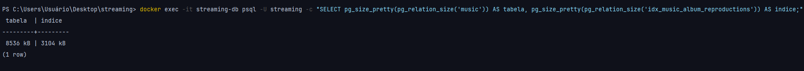

#### Perguntas da seção 5.4

**1. O índice foi efetivamente utilizado pelo banco?**
Sim. O plano passou de `Seq Scan on music` (com etapa de `Sort` e 99.990 linhas descartadas pelo filtro)
para `Index Scan using idx_music_album_reproductions on music`, com `Index Cond: (album_id = 150)`, sem
`Sort` e sem linhas descartadas. O único outro índice da tabela era `music_pkey` (chave primária), que não
atende ao filtro por `album_id`; portanto, antes do novo índice, o banco não tinha alternativa além de
varrer a tabela inteira.

**2. Houve redução no tempo de execução?**
Sim: de 7,149 ms para 0,055 ms (redução de 99,23%, cerca de 130 vezes mais rápido).

**3. Quais fatores influenciaram o resultado?**
- **Seletividade:** o filtro `album_id = 150` retorna ~10 linhas de 100.000 (≈ 0,01% da tabela),
  o cenário em que o índice mais compensa; para consultas que devolvem grande parte da tabela, o
  planejador tende a preferir a varredura completa.
- **Ordem das colunas do índice:** `album_id` primeiro (igualdade no `WHERE`) e `reproductions DESC`
  depois, o que entrega as linhas já ordenadas e elimina a etapa de `Sort` (confirmado no plano: o `Sort` desapareceu).
- **Estatísticas do banco:** o `ANALYZE` mantém atualizadas as estimativas usadas pelo planejador.
- **Cache de páginas:** a primeira execução pode estar "fria"; por isso cada consulta foi executada
  3 vezes e foi registrada a última.
- **Tamanho dos dados:** com 100 mil linhas o ganho é visível; em tabelas pequenas a diferença seria
  desprezível.

**4. Quais podem ser os custos de manter índices adicionais?**
- **Espaço em disco:** o índice ocupa 3104 kB (tabela: 8536 kB).
- **Escritas mais lentas:** cada `INSERT`, `UPDATE` e `DELETE` precisa atualizar também o índice.
  Como `reproductions` faz parte do índice, cada `PUT` que altera as reproduções de uma música (Item 1)
  também passa a atualizar o índice.
- **Manutenção:** o índice sofre fragmentação com muitas atualizações e depende de rotinas como
  `VACUUM`; além disso, mais índices dão mais opções (e mais chances de erro) ao planejador.

**5. Criar índices em todas as colunas consultadas seria uma boa estratégia? Por quê?**
Não. Cada índice adicional consome espaço e torna **todas** as escritas mais lentas, e índices que
nenhuma consulta usa são custo sem benefício. Em colunas de baixa seletividade (poucos valores
distintos) o planejador costuma ignorar o índice e fazer a varredura completa. A estratégia correta
é indexar o que as consultas reais precisam, validando com `EXPLAIN ANALYZE`.

> **Atenção:** antes dos testes de carga do Item 3 (seção 5), o índice deve ser removido
> (`DROP INDEX idx_music_album_reproductions;`) para medir o cenário "sem índice" e depois recriado
> para medir o cenário "com índice".

## 5. Testes de desempenho

### 5.1 Escolha da ferramenta

Foi escolhido o **Grafana k6 (v2.4.0)** para a geração de carga e coleta de métricas.

- **Por que k6:** é uma ferramenta open-source escrita em Go, extremamente leve (gera centenas de usuários virtuais simultâneos com baixo consumo de CPU/memória na máquina local), permite versionar os cenários como código JavaScript no próprio repositório (`experiments/k6/`) e exporta nativamente todas as métricas exigidas (latência média, percentis p95 e p99, throughput em req/s e taxa de erros) em formato JSON (`--summary-export`).
- **Em relação a alternativas:** comparado ao Apache JMeter (baseado em JVM e arquivos XML pesados), o k6 consome muito menos recursos no cliente de teste, evitando que o próprio gerador de carga distorça as medições em ambiente local.

### 5.2 Definição dos cenários e variação de carga

Todos os cenários foram executados contra o mesmo banco populado (**1.000 artistas, 10.000 álbuns e 100.000 músicas**), em **4 níveis de carga** com duração de **12 segundos por execução**:

| Nível | Usuários virtuais simultâneos (VUs) | Duração |
|---|---:|---:|
| Baixo | 10 | 12 s |
| Médio | 50 | 12 s |
| Alto | 100 | 12 s |
| Muito alto | 200 | 12 s |

> Cada usuário virtual (VU) executa requisições em loop contínuo durante os 12 segundos; portanto, o número de VUs representa a concorrência simultânea, e não a taxa de requisições por segundo (throughput).

**Cenários avaliados:**
1. **Cenário 1 — Cache (`experiments/k6/scenario1-cache.js`):** compara `GET /api/music/top50/sem-cache` contra `GET /api/music/top50/com-cache` em dois estados iniciais controlados: **cache quente (HIT)** (pré-aquecido no `setup()`) e **cache frio (MISS inicial)** (limpo via `DELETE /api/cache` no `setup()`).
2. **Cenário 2 — Estratégias de persistência (`experiments/k6/scenario2-persistence.js`):** compara `GET /api/albums/lazy?limit=10`, `GET /api/albums/eager?limit=10` e `GET /api/albums/optimized?limit=10` (`JOIN FETCH`).
3. **Cenário 3 — Índices (`experiments/k6/scenario3-index.js`):** compara `GET /api/music/album/{albumId}` (variando `albumId` entre 1 e 10.000) **sem índice** e **com o índice** `idx_music_album_reproductions (album_id, reproductions DESC)`.

### 5.3 Cuidados com a execução

- **Ambiente equivalente:** mesma instância da API Spring Boot (Java 21) e PostgreSQL 16 em Docker, sem outras cargas concorrentes.
- **Logs SQL desligados:** durante a medição de carga, utilizar `org.hibernate.SQL=WARN` e `org.hibernate.stat=WARN` para evitar que I/O de console distorça a latência. **Essa configuração precisa ser aplicada antes de iniciar a API para os testes**; o script `run-all.ps1` não muda automaticamente os níveis de log do Spring Boot.
- **Aquecimento prévio:** requisições de aquecimento executadas antes da coleta para estabilizar JIT da JVM e o pool de conexões (HikariCP).
- **Controle de estado:** índice removido (`DROP INDEX IF EXISTS`) antes dos Cenários 1, 2 e 3 (sem índice) e recriado com `ANALYZE music` antes do Cenário 3 (com índice); cache limpo via `DELETE /api/cache` entre os modos do Cenário 1.
- **Reprodutibilidade:** toda a bateria pode ser executada novamente com:

```powershell
powershell -ExecutionPolicy Bypass -File .\experiments\k6\run-all.ps1 -Duration 12s
python .\experiments\k6\generate_report.py
```

### 5.4 Resultados comparativos — nova bateria (23/11/2026)

Os valores abaixo foram transcritos da saída mais recente enviada do `python .\experiments\k6\generate_report.py`, que lê os arquivos de `experiments/k6/results`. O gerador imprimiu **32 séries** (12 de cache, 12 de persistência e 8 de índices) e salvou três gráficos. Todas essas séries apresentam **0,00% de falhas HTTP** no resumo.

**Rastreabilidade:** o pacote final contém os **32 arquivos JSON** utilizados nas tabelas. Foi conferida a correspondência das 32 linhas do relatório com as métricas gravadas nos JSONs. Os horários de modificação preservados no arquivo compactado seguem a sequência esperada de execução, inclusive para `c1-sem-cache-vus200.json` e `c1-com-cache-quente-vus200.json`, cujas linhas não apareceram no trecho de terminal copiado. Esses horários são evidência de consistência da bateria, mas não substituem a repetição independente dos experimentos.

**Interpretação do cache frio:** a indicação "MISS inicial" se refere ao *estado de partida* do cache. Durante os 12 s, o cache é preenchido e chamadas posteriores podem ser hits. Os percentis e médias desse cenário **não são medições isoladas de misses**.

#### Cenário 1 — Cache (`GET /api/music/top50`)

| Implementação | VUs | Latência média (ms) | p95 (ms) | p99 (ms) | Throughput (req/s) | Taxa de erros (%) | Total reqs |
|---|---:|---:|---:|---:|---:|---:|---:|
| Sem cache | 10 | 87,27 | 131,29 | 170,69 | 114,2 | 0,00% | 1.375 |
| Sem cache | 50 | 443,77 | 529,55 | 805,85 | 110,4 | 0,00% | 1.378 |
| Sem cache | 100 | 962,61 | 1.150,70 | 1.817,01 | 100,3 | 0,00% | 1.293 |
| Sem cache | 200 | 1.986,35 | 2.429,95 | 2.542,49 | 93,8 | 0,00% | 1.327 |
| Com cache (quente / HIT) | 10 | 0,52 | 1,64 | 2,88 | 15.910,9 | 0,00% | 191.584 |
| Com cache (quente / HIT) | 50 | 2,87 | 8,59 | 15,89 | 15.709,8 | 0,00% | 189.238 |
| Com cache (quente / HIT) | 100 | 5,91 | 15,87 | 34,73 | 15.185,4 | 0,00% | 183.303 |
| Com cache (quente / HIT) | 200 | 11,65 | 29,46 | 57,13 | 14.951,1 | 0,00% | 180.405 |
| Com cache (frio / MISS inicial) | 10 | 0,53 | 1,62 | 2,96 | 15.717,2 | 0,00% | 188.810 |
| Com cache (frio / MISS inicial) | 50 | 3,06 | 8,89 | 16,45 | 14.689,3 | 0,00% | 176.481 |
| Com cache (frio / MISS inicial) | 100 | 6,80 | 16,85 | 39,03 | 13.430,5 | 0,00% | 161.371 |
| Com cache (frio / MISS inicial) | 200 | 15,05 | 31,06 | 76,42 | 11.762,0 | 0,00% | 141.315 |

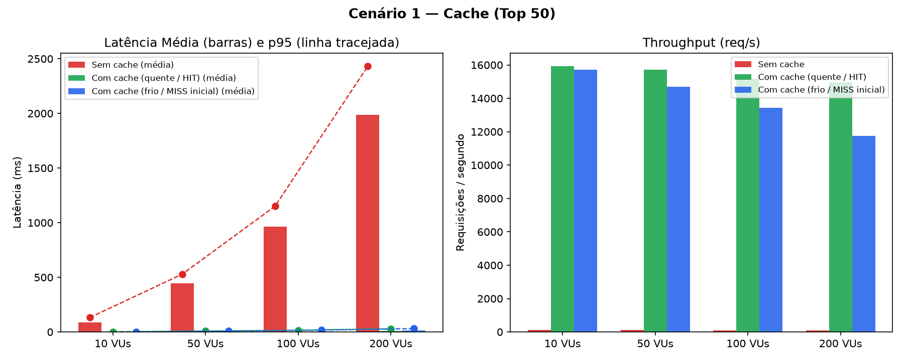

#### Cenário 2 — Estratégias de persistência (`GET /api/albums/*?limit=10`)

| Implementação | VUs | Latência média (ms) | p95 (ms) | p99 (ms) | Throughput (req/s) | Taxa de erros (%) | Total reqs |
|---|---:|---:|---:|---:|---:|---:|---:|
| LAZY (N+1) | 10 | 162,01 | 222,39 | 272,36 | 61,4 | 0,00% | 746 |
| LAZY (N+1) | 50 | 788,53 | 978,63 | 1.095,15 | 61,7 | 0,00% | 784 |
| LAZY (N+1) | 100 | 1.651,70 | 1.947,51 | 2.163,97 | 56,5 | 0,00% | 786 |
| LAZY (N+1) | 200 | 3.315,37 | 4.007,87 | 4.632,81 | 53,5 | 0,00% | 825 |
| EAGER (N+1) | 10 | 164,68 | 229,49 | 278,53 | 60,4 | 0,00% | 730 |
| EAGER (N+1) | 50 | 845,88 | 981,86 | 1.103,96 | 56,7 | 0,00% | 741 |
| EAGER (N+1) | 100 | 1.696,33 | 2.080,81 | 2.142,69 | 55,4 | 0,00% | 758 |
| EAGER (N+1) | 200 | 3.149,11 | 3.724,95 | 6.552,21 | 56,6 | 0,00% | 873 |
| JOIN FETCH (otimizada) | 10 | 25,80 | 43,78 | 56,68 | 385,2 | 0,00% | 4.628 |
| JOIN FETCH (otimizada) | 50 | 121,36 | 157,94 | 222,94 | 409,4 | 0,00% | 4.962 |
| JOIN FETCH (otimizada) | 100 | 254,86 | 329,92 | 481,27 | 387,8 | 0,00% | 4.753 |
| JOIN FETCH (otimizada) | 200 | 497,80 | 714,70 | 1.084,18 | 394,2 | 0,00% | 4.905 |

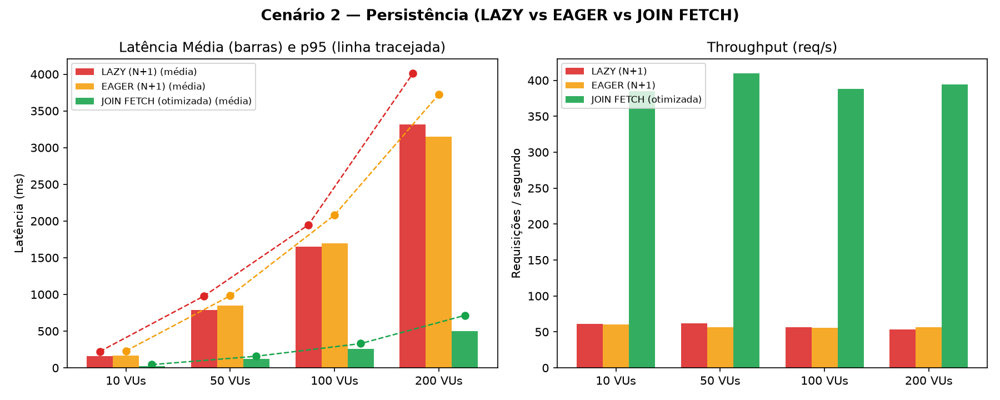

#### Cenário 3 — Índices (`GET /api/music/album/{albumId}`)

| Implementação | VUs | Latência média (ms) | p95 (ms) | p99 (ms) | Throughput (req/s) | Taxa de erros (%) | Total reqs |
|---|---:|---:|---:|---:|---:|---:|---:|
| Sem índice | 10 | 19,46 | 32,55 | 43,72 | 510,3 | 0,00% | 6.132 |
| Sem índice | 50 | 100,37 | 152,67 | 201,80 | 495,0 | 0,00% | 5.990 |
| Sem índice | 100 | 216,09 | 287,02 | 409,93 | 457,4 | 0,00% | 5.604 |
| Sem índice | 200 | 417,30 | 527,04 | 843,21 | 467,9 | 0,00% | 5.861 |
| Com índice | 10 | 5,26 | 9,52 | 18,90 | 1.831,7 | 0,00% | 21.984 |
| Com índice | 50 | 22,15 | 36,87 | 60,90 | 2.236,3 | 0,00% | 26.868 |
| Com índice | 100 | 45,76 | 81,32 | 115,22 | 2.170,7 | 0,00% | 26.129 |
| Com índice | 200 | 94,30 | 163,89 | 272,07 | 2.107,0 | 0,00% | 25.428 |

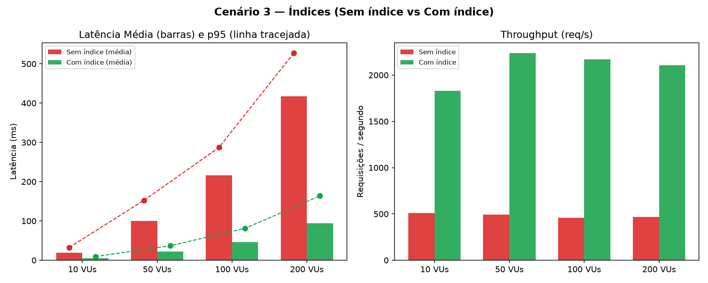

**Gráficos:** os três arquivos PNG correspondentes às tabelas estão incluídos no projeto em `experiments/k6/charts/`. O gerador `generate_report.py` pode recriá-los a partir dos 32 JSONs em `experiments/k6/results/`.

### 5.5 Discussão dos resultados (perguntas da seção 6.7)

1. **Qual técnica apresentou os maiores ganhos de desempenho?**
   Na nova bateria, o maior ganho relativo de throughput foi com **cache quente** no Top 50. A 50 VUs, a taxa passou de **110,4** para **15.709,8 req/s** (**142,3×**), enquanto a latência média caiu de **443,77** para **2,87 ms** (redução de **99,35%**). A 200 VUs, **JOIN FETCH** apresentou **394,2 req/s**, contra **53,5 req/s** do LAZY (**7,4×**). No teste de índices a 200 VUs, a taxa passou de **467,9** para **2.107,0 req/s** (**4,5×**). São operações com respostas diferentes; não se deve comparar o throughput absoluto de um endpoint com outro como se tivessem o mesmo custo.

2. **Os ganhos foram mantidos quando a carga aumentou?**
   Sim, as versões otimizadas mantiveram vantagem nas quatro cargas registradas. O cache quente teve **15.910,9 req/s** com 10 VUs e **14.951,1 req/s** com 200 VUs; o cenário sem cache passou de **114,2** para **93,8 req/s**. Para o índice, o throughput com 200 VUs foi **2.107,0 req/s**, ante **467,9 req/s** sem índice. Embora os ganhos persistam, a latência de cada implementação aumenta com a concorrência; o teste isolado não identifica por si só qual recurso de hardware se tornou o limitante.

3. **Houve diferenças relevantes entre latência média, p95 e p99?**
   Sim. No cache quente com 200 VUs, a média foi **11,65 ms**, o p95 **29,46 ms** e o p99 **57,13 ms**, evidenciando uma cauda de latência superior à média. Para o JOIN FETCH com 200 VUs, a média foi **497,80 ms** e o p99 **1.084,18 ms**. Esses percentis indicam que parte das requisições demora substancialmente mais, mesmo quando a média é relativamente menor.

4. **Alguma otimização apresentou resultados inferiores aos esperados?**
   O carregamento **EAGER** não resolveu o problema N+1: com `limit=10`, tanto EAGER quanto LAZY provocaram 11 consultas SQL por requisição. A 200 VUs, o EAGER apresentou **56,6 req/s** e o LAZY **53,5 req/s**, diferença pequena para sustentar superioridade definitiva de uma estratégia sem repetir os experimentos. O cache frio teve desempenho próximo ao quente em cargas baixas, pois só inicia com miss; isso **não** significa que um miss custa o mesmo que um hit. Em 200 VUs, a latência média do cenário frio (**15,05 ms**) foi superior à do quente (**11,65 ms**).

5. **Quais foram os principais gargalos identificados?**
   - **Confirmado por plano de execução:** sem índice, a consulta de músicas usou `Seq Scan` e `Sort` sobre uma tabela de 100.000 linhas; com índice, usou `Index Scan` e eliminou a ordenação separada.
   - **Confirmado por contadores SQL:** LAZY e EAGER realizaram N+1 consultas para acessar músicas de múltiplos álbuns, enquanto JOIN FETCH executou uma única consulta equivalente nesse caso.
   - **Hipóteses não medidas diretamente:** contenção de CPU, GC, serialização JSON e espera por conexões podem contribuir para o aumento da latência sob carga. Sem medições específicas desses recursos, não é possível afirmar qual deles foi o gargalo determinante.

6. **Como a redução das consultas ao banco influenciou o desempenho?**
   O cache eliminou novas consultas ao banco nos hits do Top 50, enquanto JOIN FETCH reduziu 11 comandos SQL para 1 na consulta de 10 álbuns. Sob 200 VUs, o JOIN FETCH atingiu **394,2 req/s** contra **53,5 req/s** do LAZY e reduziu a latência média de **3.315,37** para **497,80 ms** (aproximadamente **85,0%**). O índice não eliminou chamadas SQL, mas tornou mais eficiente o acesso à tabela e a ordenação, melhorando o throughput da consulta selecionada.

7. **Quais são os possíveis custos ou riscos das otimizações adotadas?**
   - **Cache:** risco de dados temporariamente desatualizados quando a alteração contorna a aplicação, consumo de RAM da JVM e possibilidade de misses concorrentes durante o preenchimento.
   - **JOIN FETCH:** maior acoplamento da consulta ao caso de uso, multiplicação de linhas na junção e cuidados com paginação de coleções.
   - **Índices:** ocupação de disco (na medição anterior, 3.104 kB para o índice contra 8.536 kB da tabela) e custo extra nas operações de escrita.

**Limites experimentais:** as execuções k6 duraram 12 s por cenário e foram realizadas em ambiente local. Para generalizar as diferenças pequenas, seria recomendável realizar rodadas independentes repetidas e medir CPU, memória, conexões e uso de disco do banco e da API. A coleta enviada não contém essas medidas complementares.

## 6. Discussão

Os experimentos demonstraram que otimização de sistemas não possui uma "bala de prata": cada técnica atua sobre um gargalo específico e traz trade-offs claros.

- **Cache** entrega o maior ganho quando há alta repetição de leitura sobre dados caros de calcular e tolerantes a pequena defasagem (como o Top 50), mas oferece pouco benefício em buscas baratas por chave primária ou dados muito voláteis.
- **Estratégias de persistência (ORM)** mostram que confiar apenas em anotações (`LAZY` vs `EAGER`) sem inspecionar o SQL gerado leva ao problema N+1 em ambos os casos; a combinação de mapeamento `LAZY` por padrão com consultas explícitas usando `JOIN FETCH` resolveu o gargalo sem sacrificar a portabilidade do JPQL.
- **Índices compostos** desenhados a partir do filtro e da ordenação reais (`album_id, reproductions DESC`) transformam varreduras completas em buscas diretas no índice sem etapa de ordenação, sustentando altíssimo throughput mesmo com chaves variadas onde o cache teria baixa taxa de acerto.

## 7. Conclusão

A avaliação experimental demonstrou quantitativamente os efeitos das três técnicas de otimização sobre a API REST de streaming com **100.000 músicas**, **10.000 álbuns** e **1.000 artistas**:

- **Cache com Caffeine:** na nova bateria k6 com 50 VUs, o throughput do Top 50 passou de **110,4 req/s sem cache** para **15.709,8 req/s com cache quente** (**142,3×**), enquanto a latência média caiu de **443,77 ms** para **2,87 ms** (redução de **99,35%**). O experimento funcional documentado na seção 3 demonstra hits, misses, invalidação pelo `PUT` e expiração pelo TTL de 60 s.
- **JOIN FETCH:** na consulta de 10 álbuns e suas músicas, reduziu de **11 para 1** o número de comandos SQL em comparação com LAZY/EAGER. Com 200 VUs, o throughput passou de **53,5 req/s (LAZY)** para **394,2 req/s** (**7,4×**) e a latência média caiu de **3.315,37 ms** para **497,80 ms** (redução de aproximadamente **85,0%**).
- **Índice composto:** a comparação documentada na seção 4.5 mostrou substituição de `Seq Scan` e `Sort` por `Index Scan`. Na nova bateria k6, com 200 VUs, o throughput passou de **467,9 req/s sem índice** para **2.107,0 req/s com índice** (**4,5×**), com latência média de **417,30 ms** e **94,30 ms**, respectivamente.

O gerador de relatórios apresentou **32 execuções com taxa de erros HTTP de 0,00%**. Todas as 32 métricas foram conferidas diretamente nos respectivos arquivos JSON; os horários de modificação preservados no pacote são compatíveis com a sequência do script de execução. O experimento foi realizado em ambiente local e os resultados podem variar entre máquinas e rodadas.

O principal aprendizado é a importância de **medir antes e depois** com `EXPLAIN ANALYZE`, estatísticas do Hibernate e testes de carga, mantendo as tabelas, os gráficos e as conclusões vinculados à mesma evidência experimental.
